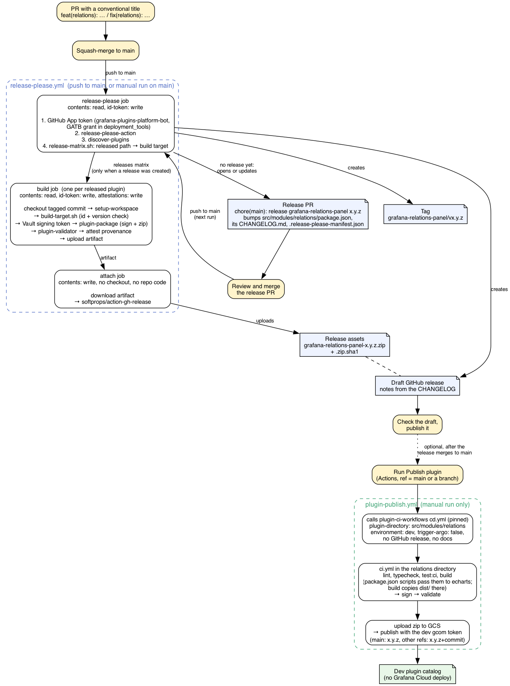

# Plugin releases

**Status: implemented, not yet run.** `release-please.yml` runs on pushes to `main`; it needs the
prerequisites at the end of this file before its first real run. Only `grafana-relations-panel` is
configured so far.

A release is a **GitHub release** with the signed plugin zip attached. A `grafana-relations-panel` release is
also **published to the dev and ops catalogs and deployed** to every dev and ops stack, by the `publish` job of
the same run (see [Publishing to dev or ops](#publishing-to-dev-or-ops)). Merging the release PR is the only
approval. Prod is never published automatically. The first plugin to release this way is `grafana-relations-panel`.

The diagram's source is [release-flow.dot](release-flow.dot) (also rendered as [SVG](release-flow.svg)); the
command to re-render it is at the top of that file.

## How a release happens

1. A PR with a conventional title (`feat(relations): …`, `fix(relations): …`) is squash-merged to `main`.
2. `release-please.yml` opens or updates that plugin's **release PR**, e.g.
   `chore(main): release grafana-relations-panel 0.2.0`, with the version bump and the new CHANGELOG
   entries.
3. Approving and merging the release PR creates the tag `grafana-relations-panel/v0.2.0` and a **draft**
   GitHub release, with that CHANGELOG section as its notes.
4. The same workflow builds the plugin from the tag, signs it, packages
   `grafana-relations-panel-0.2.0.zip` with checksums, validates it, attests its provenance, and attaches the
   files to the draft.
5. After the build passes, the `publish` job calls `cd.yml` with the release tag: it publishes the version to the
   dev and ops catalogs and starts the Grafana Cloud rollout to dev and ops (see below).
6. A maintainer checks the draft and publishes it. This no longer gates the deploy.

**One plugin or all of them:** every plugin gets its own release PR. Merge one to release that plugin;
merge several, or all of the open ones, to release them together. A plugin with no releasable changes can
be forced with a `Release-As: x.y.z` footer on a commit that touches its directory.

Only `feat` and `fix` commits (and breaking changes) open a release PR and appear in its notes. `chore`, `ci`,
`docs`, `perf` and the other types are hidden in `release-please-config.json`: release-please opens a release
for any commit whose type has a visible changelog section.

## Versions and tags

Each plugin's version is the `version` in **its own `package.json`**, which its build writes into
`plugin.json` (`%VERSION%`), the usual plugin convention. Tags are `<plugin-id>/v<version>`, the same
`<name>/v<version>` form `grafana/plugin-ci-workflows` uses for its own releases.

`grafana-echarts` publishes two plugins, so the relations panel has a `package.json` of its own in
`src/modules/relations/`, next to its own `CHANGELOG.md`. It is not a workspace package; it only carries
the panel's version. The app keeps the echarts package's `package.json`.

**Shared code caveat:** release-please decides which plugin a change belongs to by the files it touches,
using the most specific directory. A change only in echarts' shared `src/lib`, which the relations panel
also compiles, counts toward no relations release (and toward nothing at all until the app is configured).
When such a change should ship in relations, the same PR must also touch `src/modules/relations`, for
example with a line in its CHANGELOG; a `Release-As:` footer only works on a commit that touches it.

## What it reuses

As much as possible comes from `grafana/plugin-ci-workflows`, which uses release-please for its own
releases and recommends it to plugin repos. Where its pieces assume one plugin per repo, they are copied
into local actions with the same interface plus only what the monorepo needs, so they can be upstreamed:

| local action | from plugin-ci-workflows | adds |
|---|---|---|
| `release-please` | `actions/plugins/release-please` | inputs for the GitHub App and config files; all of release-please's outputs as one JSON output; no checkout |
| `plugin-package` | `actions/internal/plugins/package` (sign + zip) | universal zip only (no backends here); `@grafana/sign-plugin` pinned |
| `plugin-validator` | the validator step in `ci.yml` | packaged as an action, with the same image, arguments and default config; `source-version` for a plugin whose version is not in its source `package.json` (relations) |

It also reuses this repo's `discover-plugins`, `setup-workspace` and `scripts/build-target.sh`, which checks
that the built `plugin.json` carries the tagged version. `scripts/release-matrix.sh` matches each released
package to its build target: a package's `component` in `release-please-config.json` is its plugin id. The
draft release and its notes come from release-please. Attaching the zip uses `softprops/action-gh-release`,
as `cd.yml`'s GitHub release job does; it keeps release-please's notes and the draft state.

**Adding a plugin:** a package entry in `release-please-config.json` (`release-type: node`, `component` = the
plugin id), its current version in `.release-please-manifest.json`, and a `CHANGELOG.md` next to its
`package.json`.

## Publishing to dev or ops

Every release does this for dev and ops automatically (`release-please.yml`, `publish` job). It passes the tag
as `cd.yml`'s `branch` with a `release-reference-regex` matching it, so `cd.yml` publishes the exact tagged
commit with no `+<commit>` suffix, even if `main` has moved on. If that job fails, re-run it from the Actions
run; don't re-publish `main` by hand while the catalog already has that version.

`plugin-publish.yml` publishes `grafana-relations-panel` to the **dev** or **ops** plugin catalog when run by
hand (**Actions → Publish plugin → Run workflow**, pick the catalog). Each catalog takes the same version
once, so publishing 0.1.1 to ops after dev is not a conflict. A new plugin needs a stub on grafana.com (prod)
first; `cd.yml` then creates the dev or ops stub itself. It calls `grafana/plugin-ci-workflows`' `cd.yml`, as
`grafana-canvas-panel` does: `cd.yml` builds, tests, signs and validates the plugin, uploads the zip to GCS
and publishes it. It creates no tag or GitHub release.

- **Publishing `main` deploys to Grafana Cloud.** The plugin is provisioned on every dev and ops stack.
  After the catalog publish, `cd.yml` starts Grafana's internal rollout (`trigger-argo`,
  `grafana-cloud-deployment-type: provisioned`), which moves dev and ops onto the new version with no
  further approval.
- **A branch publish only reaches the catalog.** The rollout is off for any ref but `main`, so a
  `<version>+<commit>` build never rolls out to every stack. Maintainers can try it on a single stack.

- **`cd.yml` is pinned to a tag, not a hash**, the one such `uses:` in this repo. `cd.yml` fails a caller
  that pins it to a hash, and the Google workload identity in [Credentials](#credentials) trusts it only at
  `main` or a semver tag. To bump it, change the `ci-cd-workflows/vX.Y.Z` tag and the commit noted above it.

- **From `main`** the catalog version is the one in `plugin.json`. Any other ref publishes
  `<version>+<commit>`, so a branch can be tried in dev before it merges. The catalog takes each version
  once: publishing `main` again without a version bump fails as a conflict.
- **`cd.yml` builds from a plugin directory** by running `lint`, `typecheck`, `test:ci` and `build` there and
  reading `dist/`. For relations that directory is `src/modules/relations`, whose `package.json` scripts pass
  the work to the echarts package, and whose `build` copies the standalone build into `dist/` there. It also
  carries the `packageManager` and `.nvmrc` that `cd.yml` reads, synced to the workspace root. The app build
  leaves that `dist/` and `package.json` out.
- **`cd.yml`'s plugin validator is off.** It compares the zip with the plugin directory's source, and that
  directory has only the delegating scripts, so it fails. Releases validate the same build against the echarts
  source instead.

## Design rules

- **The job that writes to the release builds nothing.** Building and signing run in a job that can only
  read the repo. A separate job holding `contents: write` only downloads that job's artifact and attaches
  it, the same split as the PR-comment jobs in Plugin CI.
- **The signing token comes from Vault**, the same secret `plugin-ci-workflows` uses, never from a repo
  secret. See [Credentials](#credentials).
- **Release PRs and tags are made with a GitHub App token**, as upstream's action does, so they trigger CI
  and their commits are signed, which the repo requires on every branch.

## Credentials

Every credential is short-lived and obtained through the job's GitHub OIDC token (`id-token: write`); there are
no repo secrets. Each login checks different claims of that token, which matters because **dataViz uses
GitHub's immutable OIDC subject**: its `sub` claim is `repo:grafana@7195757/dataViz@1301820546:…`, not
`repo:grafana/dataViz:…` (`gh api repos/grafana/dataViz/actions/oidc/customization/sub`).

The numbers in that subject are IDs, not secrets:

| part | meaning | check it with |
|---|---|---|
| `repo:` | fixed prefix for a repository subject | |
| `grafana@7195757` | org name `@` the `grafana` org's numeric ID | `gh api orgs/grafana --jq .id` |
| `dataViz@1301820546` | repo name `@` dataViz's numeric ID | `gh api repos/grafana/dataViz --jq .id` |
| `:…` | the rest, filled in per run, e.g. `ref:refs/heads/main` for a push to `main` | |

GitHub uses this format for repositories created, renamed or transferred after July 15, 2026
([immutable subject claims](https://docs.github.com/en/actions/reference/security/oidc#immutable-subject-claims)).
Names can be reused: a later repository with the same name would get the same `repo:grafana/dataViz:…`
subject, while IDs are never reused, so a binding on the IDs trusts only this repository. The GitHub App
grant is bound to `repo:grafana@7195757/dataViz@1301820546:*`; the trailing `*` does not widen it, because
the grant also requires `workflow_ref` (the workflow file on `main`) and `event_name`.

| credential | used by | obtained through | OIDC claims checked |
|---|---|---|---|
| GitHub App token (contents, pull-requests, issues write) | `release-please.yml`, release-please job: release PRs, tags, draft releases | `grafana/shared-workflows` `create-github-app-token` | `sub` (the immutable form), `workflow_ref` (`.github/workflows/release-please.yml` on `main`), `event_name` (`push`, `workflow_dispatch`) |
| Plugin signing token | `release-please.yml` build job (Sign and package); `plugin-publish.yml`, inside `cd.yml`'s CI | `grafana/shared-workflows` `get-vault-secrets`, shared by every `grafana` repo | `sub` matches `repo:grafana/*` or `repo:grafana@7195757/*` (both forms) |
| Catalog publish token | `plugin-publish.yml`, inside `cd.yml`'s publish job | same as the signing token | same as the signing token |
| Google credentials (GCS upload, dev and ops catalog APIs) | `plugin-publish.yml`, inside `cd.yml` | Google workload identity | `repository_owner` is `grafana`, and attributes such as `repository_id` and `job_workflow_ref`; not `sub` |
| `GITHUB_TOKEN`, `contents: write` | `release-please.yml` attach job (upload to the draft release) | GitHub | none |

Only the GitHub App token checks `sub` against a value set for this repo, so it is the only credential the
immutable subject affects. A token-step failure with `claim "sub" does not match any associated bound claim
values` means the grant's subject is missing or wrong; `role … could not be found` means the grant is not
applied yet.

## Before it can run

- **Squash merge**, with the PR title as the commit message, so each PR is one changelog entry.
- **The GitHub App grant** described under [Credentials](#credentials), bound to the immutable subject.
- **The GitHub App installed on this repo**, or the App token step fails even with the grant.
